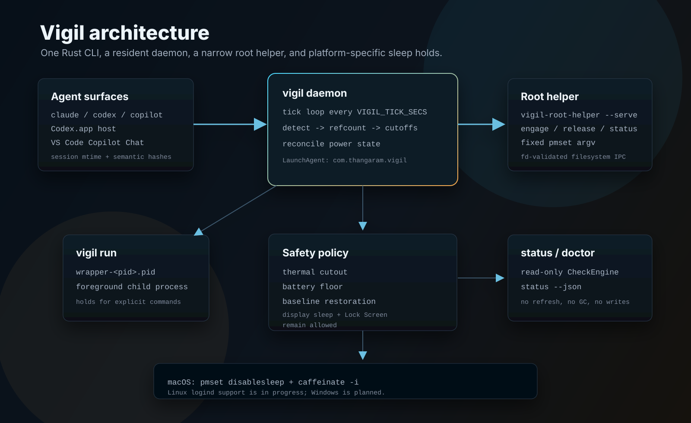

# Architecture



## Current (Rust, single self-contained binary)

There is no bash daemon and no `lib/*.sh` anymore — those were deleted in the
5.7 cutover. Vigil is a single Rust workspace. The user-facing `vigil` binary
runs the resident daemon under a hidden `daemon` subcommand; a separate root
binary, `vigil-root-helper`, runs the privileged power helper. The two
communicate only through a per-uid, file-based IPC queue. A third native binary,
`vigil-lock-helper`, implements the optional input-freeze (`vigil lock`).

```
                ┌─────────────────────────────────────────────────┐
                │ launchd LaunchAgent (gui/{uid}, KeepAlive)      │
                │   com.thangaram.vigil                           │
                │   ProgramArguments = [<install>/bin/vigil,      │
                │                       daemon]                   │
                └──────────────────────┬──────────────────────────┘
                                       │ runs
                                       ▼
   ┌────────────────────────────────────────────────────────────────┐
   │ vigil daemon  (Rust tick loop, default 5s, VIGIL_TICK_SECS)    │
   │  ├─ procscan: one sysinfo::System, process identities           │
   │  │     match: cli-claude/codex/copilot, app-codex,             │
   │  │            app-vscode-copilot-chat                          │
   │  ├─ refcount: one *.pid file per match in state/active/        │
   │  ├─ activity: per-session reducers + uncertain fallback        │
   │  │     VS Code Copilot Chat content-hash                       │
   │  ├─ thermal: pmset -g therm (CPU_Scheduler_Limit floor)       │
   │  ├─ battery: pmset -g ps (VIGIL_BATTERY_FLOOR_PCT)            │
   │  ├─ on engage: snapshot baseline.json + caffeinate -i         │
   │  └─ on release: kill caffeinate + clear baseline.json         │
   └───────────────────────────────┬────────────────────────────────┘
                                    │ per-uid IPC queue (req.<id>/resp.<id>)
                                    │ exactly one of engage / release / status
                                    ▼
   ┌────────────────────────────────────────────────────────────────┐
   │ launchd LaunchDaemon (system, KeepAlive)                       │
   │   com.thangaram.vigil.helper                                   │
   │   vigil-root-helper --serve  (long-lived poll loop, root)     │
   │  ├─ claim req via renameat into root-owned processing/        │
   │  ├─ fstat-validate: regular, owner==allowed-uid, nlink==1,    │
   │  │     not group/other-writable, body ≤ 64 bytes              │
   │  ├─ accept only one action: engage / release / status         │
   │  └─ run FIXED /usr/bin/pmset -a disablesleep 0|1 (env_clear)  │
   └───────────────────────────────▲────────────────────────────────┘
                                    │
                writes wrapper PID  │
                file (RAII guard)   │
   ┌────────────────────────────────┴───────────────────────────────┐
   │ vigil run <cmd> [args...]                                       │
   │   - write wrapper-<pid>.pid into state/active/                  │
   │   - run "<cmd> args" as a foreground subprocess (NOT exec)      │
   │   - RAII PidfileGuard removes the pidfile on return             │
   │   - propagate child exit code (128+sig on signal, 127 ENOENT)  │
   └────────────────────────────────────────────────────────────────┘

   status/doctor read this whole picture through ONE read-only CheckEngine:
   it scans pid/tick/state files + launchctl, never writes/refreshes/GCs.
```

## Signal flow

One shared `ActivityCollector` supplies daemon, recovery and diagnostics. A
process host is an anchor for native session evidence, not a working-session
count. Collection validates PID/start, parentage, same-user and non-zombie
identity. Only candidate commands have the three native session markers read;
other environment variables are discarded. Codex rollout association uses a
bounded read-only `lsof`, without connecting to private APIs or issuing provider
list commands.

Claude, Codex and Copilot retain their own native lifecycle semantics. Session
aggregation prefers verified running work, then unresolved evidence, then fully
observed human waits, then idle. Independent commands/children survive parent
waits, turn completion and abort until their own terminal or exit evidence.
A witnessed command can remain attributed after reparenting while its PID/start
matches; this witness is in memory only. Cold detached-command attribution and
Codex approval waits remain explicit coverage limits.

JSONL history is buffered incrementally: 64 KiB chunks, an 8 MiB complete-record
limit and a 16 MiB read budget per evaluation. Partial, replaced, truncated,
malformed or oversized evidence produces unknown reconstruction. Required
history continues on later daemon ticks; unchanged files read no transcript
bytes after stat. These limits do not create a work-expiry timer.

`ActivitySnapshot` contains sessions, detected hosts, wrappers, the existing
VS Code content-hash gate and uncertain demand. Exact working-session counts
never come from multiplying a provider boolean by pidfile count. Recent-file
fallback uses the configured idle window only for unresolved evidence and
contributes at most one uncertain demand per provider. A currently owned
unfinished native lifecycle with ambiguous wait state retains uncertain demand
until its matching end or ownership invalidation.

Pidfiles retain process/wrapper lifecycle bookkeeping. Wrapper registration uses
the actual process start from the scanner's identity source. GC drops verified
exit/reuse; low CPU does not disprove quiet native work. `vigil run` keeps its
foreground child and removes the wrapper pidfile on exit.

Transitions preserve the power ordering: capture baseline and engage the helper
before starting `caffeinate -i`; reconcile an ongoing hold without recapturing
baseline; release through the helper and clean the caffeinate child/baseline.
Thermal, battery, cooldown and manual-off outrank automatic demand.

Automatic work/uncertainty/VS Code demand starts a monotonic 30-second grace when
its observed count becomes zero. Wrappers and manual-on are separate demand.
There is no grace at startup. Refresh consumes a pending grace; later ticks
cannot resurrect it. Guards/manual-off consume old grace immediately during
evaluation. New observed work can establish a new grace cycle.

## How the two launchd jobs are wired

- **LaunchAgent** `com.thangaram.vigil` (per-user, `gui/{uid}`): plist at
  `~/Library/LaunchAgents/com.thangaram.vigil.plist`. Its `ProgramArguments` is
  the two-element `["<install_dir>/bin/vigil", "daemon"]` — the installed
  snapshot binary plus the hidden `daemon` subcommand, never invoked directly by
  users. Keys: `RunAtLoad`, `KeepAlive`, `ProcessType=Background`,
  `ExitTimeOut=60` (sized for the cleanup path: helper release, kill caffeinate,
  drop baseline, release lock), `ThrottleInterval=10`. It carries a fixed
  `EnvironmentVariables` dict (`PATH`, `VIGIL_STATE_DIR`, `VIGIL_LOG_DIR`);
  stdout/stderr go to `daemon.out.log` / `daemon.err.log` under the log dir.

- **LaunchDaemon** `com.thangaram.vigil.helper` (system, root): plist at
  `/Library/LaunchDaemons/com.thangaram.vigil.helper.plist`. Its
  `ProgramArguments` is the frozen 14-element `vigil-root-helper --serve
  --request-dir … --response-dir … --state-dir … --log-file … --allowed-uid …
  --allowed-user …`. The `--allowed-uid`/`--allowed-user` are baked at install
  time from the current uid/username, never from request content. Keys:
  `RunAtLoad`, `KeepAlive`, `ProcessType=Background`, `ExitTimeOut=10`,
  `ThrottleInterval=10`. The `KeepAlive`+`ThrottleInterval=10` pair is what
  makes a crashed helper restart and re-validate. There is no
  `EnvironmentVariables` dict.

The labels `com.thangaram.vigil` and `com.thangaram.vigil.helper` are hardcoded
and never overridable. The live plist renderer in `service/mod.rs` is
authoritative; the stale template `etc/com.thangaram.vigil.plist.in` still shows
the old single-element `@VIGIL_DAEMON_PATH@` argv and is not the source of truth.

## The root helper: long-lived `--serve` with an IPC queue

`vigil-root-helper` is **not** a per-request one-shot. Its `main()` is a thin
shell: `parse_args` → `require_root` (`geteuid()==0`; the non-root bypass is
compile-time-only and cannot be flipped by any env var) → `--once` (one pass) or
`--serve` (forever loop `loop { run_once(); sleep(poll_secs) }`, `poll_secs`
default 1, floored ≥1). Each `--serve` iteration re-validates the IPC dirs,
cleans up `processing/` leftovers from a crashed prior instance (KeepAlive
restart), then processes pending requests; validation failures are swallowed and
retried next tick.

**IPC protocol.** The client (daemon) writes a request file `0600` via
`O_CREAT|O_EXCL` then atomically renames it to `req.<id>` (high-entropy id). The
helper claims it by `renameat`-ing it into the root-owned `processing/` subdir,
`O_NOFOLLOW`-opens the moved file, `fstat`s **that fd** (must be a regular file,
owner == allowed-uid, `nlink==1`, not group/other-writable), reads the body
bounded to 64 bytes from the **same fd**, and parses exactly one of
`engage|release|status` on a single newline-terminated line with no trailing
content. Every check operates on an fd's `fstat`, never a path-based
`metadata`/`is_file`, to close TOCTOU and symlink-redirect attacks. On any
rejection the helper removes the moved file and (when the id is charset-valid)
writes an error response, so a rejection never becomes a client timeout and the
queue never accumulates poison files. The helper writes a five-line
`key=value` response (`status/action/baseline/current/message`) via `O_CREAT|O_EXCL`
temp → `fchmod 0644` → `renameat` to `resp.<id>` relative to the validated
response-dir fd. The client polls the response dir up to
`power_helper_timeout_secs`, validates `resp.<id>` once with `O_NOFOLLOW` +
fstat (uid==0, regular, `nlink==1`, not group/other-writable) and reads from the
same fd. Helper validates requests, client validates responses; neither side's
validation is optimized away.

**Helper-side action semantics** (root):

- `engage`: idempotent baseline capture (read live `SleepDisabled`, write the
  helper's own `state_dir/baseline` `0600` unless already engaged + present),
  run `pmset` set 1, mark `state_dir/engaged`. On pmset failure → error,
  engaged is NOT marked.
- `release`: if NOT engaged → no-op (must not clobber an externally-set
  `SleepDisabled`); else target = the helper's baseline (corrupt/missing ⇒ 0,
  fail-safe), run `pmset` set target, mark released, KEEP the baseline file. On
  pmset failure → error, KEEP engaged for retry.
- `status`: always ok.

The helper keeps its own `baseline`/`engaged` state files under its `state_dir`,
distinct from the daemon-side `baseline.json`.

## Daemon tick loop

The daemon collects processes once, updates/GCs identity records, evaluates the
shared activity snapshot, applies guards/manual mode/grace, performs the power
transition, then atomically writes the **post-action** tick. The interruptible
wait honors INT/TERM and SIGUSR1; SIGUSR1 requests a wakeup, not proof of refresh.
Recovery uses the same activity collector before retaining a leftover baseline.
It does not restore old grace or recreate detached-work ownership from old files.

Single-instance remains guarded by the existing directory lock. Clean shutdown
releases the hold, removes daemon pid/tick state and releases the lock. The
closed-lid follow-ups remain required: `sleepnow` after release and
`displaysleepnow` when the lid closes under a hold.

## Tick schema and refresh

`daemon.tick` schema 2 has one deterministic key/value parser and atomic writer.
It includes daemon PID/start, evaluation sequence, session/host/wrapper counts,
VS Code and uncertain demand, grace remaining, mode/guard/desired/post-action
engaged state and an optional refresh token. Legacy ten-field ticks remain
readable as policy, with unknown session counts and refresh unsupported.
The menu reads this cache alone and displays its age; it does not scan transcripts.

`vigil refresh` serializes callers using a user-only advisory lock, writes an
atomic request with a unique token and expected daemon identity, validates the
actual daemon executable/role/PID/start, then sends SIGUSR1. Its single 2-second
deadline includes serialization. The daemon captures the token before evaluation
and acknowledges that same token only in the post-action tick. A request arriving
during a scan is left for another pass. Ordinary ticks, legacy ticks and a
replaced daemon cannot acknowledge the request. Timeout reports unknown outcome.
The command never starts an absent daemon or clears genuine work/uncertain demand.

## status / doctor / debug

Diagnostics use the same collector/reducers and read the cached VS Code gate,
without creating files, GC, provider list commands or helper requests. Status
JSON schema 2 separates fresh `activity` from `cached_policy` and includes policy
age/identity plus per-session evidence, reason and foreground wait. It replaces
legacy active/total pidfile ratios with explicit working/waiting/idle/unknown
counts, detected hosts, wrappers and uncertain demand.

The helper view validates static installation/IPC permissions and reads launchd
and available process identity. Responsiveness is **unchecked**: presence does
not verify a responsive helper. This is a warning, so doctor and power doctor
exit 0 when required static checks pass. Concrete missing/invalid installation
remains an error. `status` always exits 0 except for invalid usage. Operational
power paths retain the separate helper IPC contract.

## Why a root helper instead of runtime sudo

The daemon runs under user-domain `launchd` with no controlling tty. Runtime
`sudo` either needs a brittle `NOPASSWD` rule or risks blocking with no password
prompt. Vigil installs one root LaunchDaemon helper during `vigil setup`; normal
runtime does not execute `sudo`.

The helper boundary is intentionally narrow:

- request actions are only `engage`, `release`, and `status`;
- the helper rejects symlinks, non-regular files, unexpected owners,
  group/other-writable request files, unknown actions, and extra request
  content — and every check is an fstat on a claimed-and-moved fd, not a
  path-based stat, so symlink-redirect and TOCTOU are closed;
- request files with multiple hard links are rejected (`nlink==1`), and request
  bodies are bounded to 64 bytes;
- helper response, state, and log directories are root-owned and not
  group/other-writable; the user daemon also rejects helper response files that
  are not regular, root-owned files;
- the helper runs only the fixed `/usr/bin/pmset -a disablesleep 0|1` argv,
  built with `env_clear()` and a pinned `PATH`, never from request content;
- the helper tracks active engagement separately from its retained baseline, so
  each fresh engage re-captures current system state and idle releases do not
  run `pmset`;
- setup/uninstall may still prompt for admin access to install, bootstrap,
  bootout, or remove root-owned files.

This reduces noisy repeated sudo execution but increases responsibility: Vigil
owns a persistent privileged component, so the request queue is treated as a
real privilege boundary. Development tests reinforce that boundary by setting
`VIGIL_TEST_NO_ADMIN=1` so admin paths refuse to run.

## Why baseline restoration matters

If you have Amphetamine or another tool already holding `disablesleep=1` when
Vigil engages, a naive design would set it back to `0` on release — clobbering
the other tool's setting. Vigil snapshots the prior value at the first acquire
(into the daemon's `baseline.json` and the helper's own root-owned baseline) and
restores exactly that on the last release.

### Baseline stickiness: `SleepDisabled=1` is captured and re-captured

If `SleepDisabled=1` is the value vigil captures on its first engage — because
another tool was already holding it, or a prior vigil crash left it pinned —
every subsequent release restores to `1`, and the **next** engage re-captures
`1` (since `baseline.json` was cleared on release and the live value is still
`1`). The daemon log will then show a captured baseline of `1` on every engage.
This is the design working as intended: vigil never lowers a sleep-prevention
flag it didn't originally raise. Helper-side baseline parsing is fail-safe to
`0` on a missing/corrupt/out-of-range value, so it never reports a stuck `1`.

To reset the baseline back to `0`-state — i.e., to make vigil release all the
way to sleep-enabled on the next quiet window — do one of:

- While Vigil has **no demand or grace** (no `baseline.json` on disk): release the
  other sleep-prevention tool, or intentionally reset `SleepDisabled` as an admin
  outside Vigil. The next vigil engage will then capture `0`, and the next release
  will go back to `0`.
- `vigil uninstall && vigil setup` — uninstall restores baseline and clears
  state; setup starts fresh.

If another tool (Amphetamine, an open `caffeinate` shell, etc.) is the *reason*
`SleepDisabled=1` keeps coming back, Vigil cannot fix that — the other tool will
re-assert. Quit the other tool first.

## Crash recovery

If the daemon restarts and finds `baseline.json`, it refreshes live process
evidence through the shared collector before deciding what to do. If verified or
uncertain work or wrappers still demand a hold and thermal/battery guards allow it,
vigil keeps the captured baseline and reasserts `SleepDisabled=1` plus
`caffeinate -i`. If no active work remains, it restores the captured baseline and
clears the stale state. This recovery runs once, before the tick loop starts.

## Why `caffeinate -i`

Reading `man caffeinate`:

- `-d`: prevent display sleep. Deliberately not used; Vigil should allow display
  sleep and native lock.
- `-i`: prevent system idle sleep. Useful.
- `-m`: prevent disk idle sleep. Cosmetic — doesn't affect agent runtime.
- `-s`: prevent system sleep. **Only effective on AC power**; no-op on battery.
- `-u`: declare user active. **Requires `-t <timeout>`** to be useful — without
  it, the assertion times out in 5 seconds.

For Vigil's unified mode, `pmset disablesleep` (via the root helper) is the
strongest available best-effort lever for system/lid sleep, and `-i` is the
correct narrow caffeinate assertion: it prevents idle system sleep while allowing
display sleep. Caffeinate liveness is checked by identity — the recorded PID must
still be alive, its `ps` basename must be `caffeinate`, and it must not be
holding a display assertion (any `-…d…` flag cluster is rejected). The
replacement-kill is gated on `basename==caffeinate`, so a PID the OS recycled
onto an unrelated process is never SIGTERMed.

## Why per-user state and log paths

`/tmp/vigil/...` was an early draft. Two problems:

1. `/tmp` (i.e. `/private/tmp`) is periodically cleaned and may be empty after
   long uptime; symlink attacks are easier to mount in shared `/tmp`.
2. **launchd opens log files before exec'ing the program.** If the log directory
   doesn't exist when launchd tries to open the log files, the daemon fails to
   start with no useful error. Putting log paths under a directory that the
   installer creates first is the only reliable pattern.

So:

- State: `~/Library/Application Support/vigil/state/` (mode 0700, created by
  `vigil setup`; default `<install_dir>/state`). Contains `active/`,
  `baseline.json`, `caffeinate.pid`, `daemon.pid`, `daemon.tick`, `state.lock`,
  `vscode-copilot-chat.state`, and the serialized `refresh.lock` /
  `refresh.request` protocol slot.
- Logs: `~/Library/Logs/vigil/` (created by `vigil setup`); the daemon log is
  `<log_dir>/daemon.log`.

The root helper's tree lives separately under `VIGIL_ROOT =
/Library/Application Support/vigil` with per-uid IPC dirs
(`helper/requests/<uid>`, `helper/responses/<uid>`), `helper/state`, and
`helper/logs/helper.log`.

## Why the daemon binary is COPIED out of the source repo

macOS TCC (Transparency, Consent, Control) ties a granted automation / full-disk
authorization to a specific binary path + signature, and denies user-domain
launchd the permission to execute binaries under `~/Documents/`. If the
LaunchAgent pointed at the build inside `~/Documents/projects/.../vigil`,
launchd would refuse to spawn it (and rebuilding in place would invalidate any
grant), breaking power assertions. Granting Terminal full disk access does not
carry over to launchd.

The fix is the standard macOS LaunchAgent pattern: install the binary out of the
protected directory. `vigil setup` (and `vigil reload`) build the workspace and
copy the `vigil` and `vigil-lock-helper` binaries into `install_dir`
(default `~/Library/Application Support/vigil/`), and the rendered LaunchAgent
plist points its `ProgramArguments` at the installed snapshot
`<install_dir>/bin/vigil daemon` — not at `~/Documents` and not at the PATH
symlink. (`setup` also symlinks the freshly-built dev binary onto PATH at
`~/.local/bin/vigil` for the user's own invocations and for `reload` to find the
repo above it.) There is now exactly one shipped `vigil` binary — the daemon is a
hidden subcommand of it — plus the separate root `vigil-root-helper`; the old
`bin/vigil-daemon` and `lib/*.sh` no longer exist.

Trade-off: edits to the source repo do not auto-propagate to the running daemon.
`vigil reload` re-syncs (rebuild + copy install binaries, heal the PATH symlink,
re-render the plist, then bootout→bootstrap) in one shot — no `kickstart -k`. A
symlink in the install dir back to the source tree would NOT have helped, because
TCC denies launchd from following symlinks into `~/Documents/` just as it denies
direct execution.
